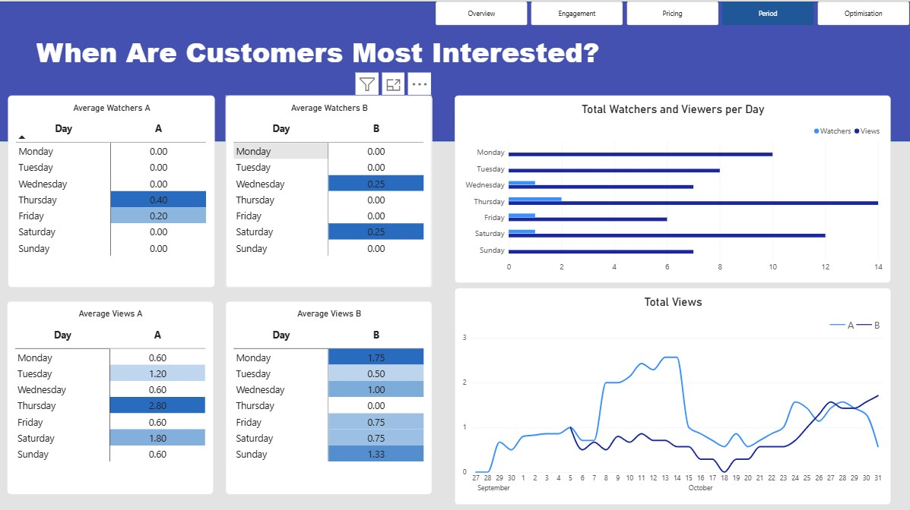

# eBay Shop 1 Month Analysis

### 1. Project Overview
Looking into two products I listed on Ebay (Product A and Product B), I compare and delve into each listing using daily performance and listing modification records.

The objective is to understand how modifications to product listings, pricing and sales activity influence customer engagement and listing performance.

Using PostgreSQL and SQL, I collected, organised and analysed listing data to identify patterns in views, watchers and sales. The results were then visualised using Power BI to make comparisons between the two products and identify potential trends.
### 2. Business Questions
* Which product generates more customer interest?
* How does customer engagement change when prices change?
* When are customers most interested?
* What changes are followed by increase in customer engagement?

### 3. Tools & Technologies
**PostgreSQL :**   Data storage & management

_______________________________
**SQL :** Data cleaning, transformation and analysis
_____
**Power BI :** Data visualization and dashboard creation
_____
**Excel / CSV :** Data collection, storage and organization
_____
**GitHub :** Project doccumentation and version control

### 4. Dataset Description 
Two main datasets:

#### Daily Performance  
Records the daily performance of product A and B.

Key Variables: 

* Date
* Product
* Sales
* Price
* Price + delivery
* Views
* Watchers
#### Listing Changes
Records modifications made to the eBay listings.

Key Variables:

* Date of modification
* Product
* Change type
* Description

Both were used interwindingly to investigate relationships between listing modifications and performance.

### 5. Data Analysis & Methodology 

* Aggregating daily views and watchers.
* Calculating average views and watchers by weekday.
* Comparing Product A and Product B.
* Calculating customer engagement using watchers relative to views.
* Identifying listing modifications and measuring p listing modifications and measuring p*erformance before and after changes.
* Comparing average views and watchers in the seven days before and after modifications.
* Investigating changes in listing performance following sales.

The analysis uses PostgreSQL queries to transform the raw data into datasets suitable for visualisation.

### 6. Power BI Dashboard

The SQL analysis was imported into Power BI in order to create visualizations.

The dashboard focuses on:

* Daily views and watchers
* Product A vs Product B performance
* Average engagement by day of the week
* Performance before and after changes
* Views and Watchers after sales
* Relationship between listing changes and customer engagement 

### Dashboard preview

## 7 Key Findings

* Overall Product A had more views and watchers on the listing but Product B had a higher engagement rate. However in terms of sales both had 1.

* It was not clear if views was increasing as price was decreasing. Regardless, views was stable with sudden increases. This could be an anomaly or due to certain changes.

* Disregarding some of the anomolies the most active days for views were Thursday, Saturday and Monday.

* Overall changes were an impact on views. Making some sort of change seemed to increase average views even if slightly. The biggest factors were price change and sales. After the first sale views shot up and it brought in the most views recorded in a single day, 11 views.

### 8. Limitations & Future Improvements
Limitations:

* Dataset only includes 2 products.
* Data set was only recorded over a span of roughly a month.
* Limited number of sales. Larger dataset = Higher accuracy.
* Changes in views and watchers could be influenced by external factors not listed.
* Product B was listed after product A so less information was gathered over a period of time.

Future improvements:

* Collect data over a longer period
* Add additional products
* Increase number of observations

### 9. Conclusion
This project demonstrates the use of SQL and Power BI to investigate e-commerce listing performance.

By combining daily performance records with listing modification data, the project explores how changes in pricing, listing activity and sales relate to customer engagement.

It also demonstrates the process of collecting, structuring, analysing and visualising data to support data-driven decision-making.
### Information
