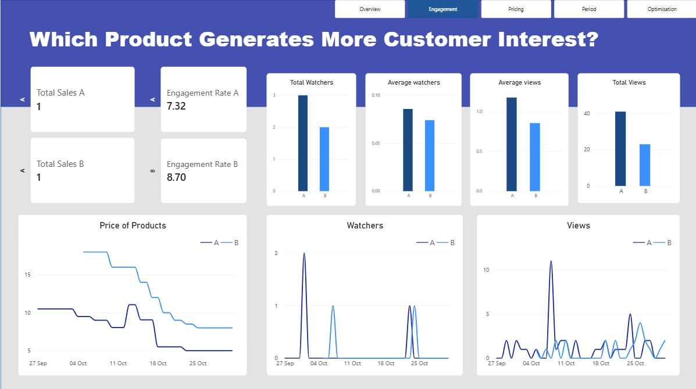
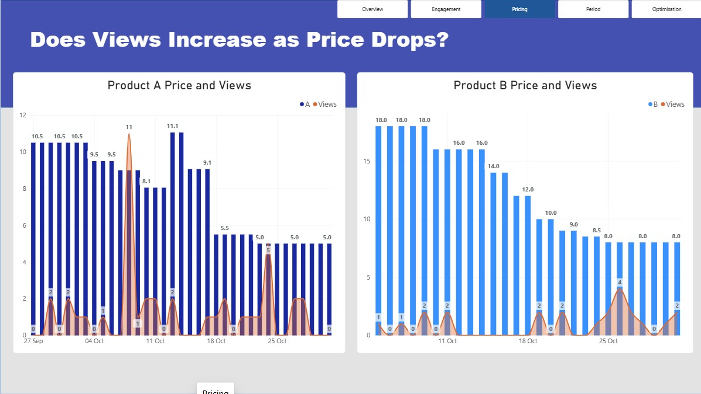

# eBay Shop 1 Month Analysis

### 1. Project Overview
Looking into two products I listed on eBay (Product A and Product B), I compare and delve into each listing using daily performance and listing modification records.

The objective is to understand how modifications to product listings, pricing and sales activity influence customer engagement and listing performance.

Using PostgreSQL and SQL, I collected, organised and analysed listing data to identify patterns in views, watchers and sales. The results were then visualised using Power BI to make comparisons between the two products and identify potential trends.

### 2. Business Questions

1. Which product generates the highest number of views?
2. Which product has the highest engagement rate?
3. How do views and watchers change following listing modifications?
4. Are price reductions associated with increased views?
5. Are certain days of the week associated with higher traffic?
6. Is sales activity associated with changes in listing views?
7. Which listing modifications show the most promising results?

### 3. Tools & Technologies
**PostgreSQL :**   Data storage & management

_______________________________
**SQL :** Data cleaning, transformation and analysis
_____
**Power BI :** Data visualization and dashboard creation
_____
**Excel / CSV :** Data collection, storage and organization
_____
**GitHub :** Project documentation and version control

### 4. Dataset Description 
Two main datasets:

#### Daily Performance  
Records the daily performance of product A and B.

Key Variables: 

* Date
* Product
* Sales
* Price
* Price + delivery
* Views
* Watchers
#### Listing Changes
Records modifications made to the eBay listings.

Key Variables:

* Date of modification
* Product
* Change type
* Description

Both were used interwindingly to investigate relationships between listing modifications and performance.

### 5. Data Analysis & Methodology 

* Aggregating daily views and watchers.
* Calculating average views and watchers by weekday.
* Comparing Product A and Product B.
* Calculating customer engagement using watchers relative to views.
* Identifying listing modifications and measuring performance before and after changes.
* Comparing average views and watchers over seven-day periods before and after modifications.
* Evaluating engagement changes following sales.
* Calculating watcher-to-view engagement rate:
  (Total Watchers / Total Views) * 100.

The analysis uses PostgreSQL queries to transform the raw data into datasets suitable for visualisation.

### 6. Power BI Dashboard

The SQL analysis was imported into Power BI in order to create visualizations.

The dashboard focuses on:

* Daily views and watchers
* Product A vs Product B performance
* Average engagement by day of the week
* Performance before and after changes
* Views and Watchers after sales
* Relationship between listing changes and customer engagement 

### Dashboard preview

## 7. Key Findings

* Product A generated higher overall traffic and watcher volume. However, Product B achieved a higher watcher-to-view ratio, suggesting stronger relative engagement despite receiving fewer views.

* It was not clear if views was increasing as price was decreasing. Regardless, views was stable with sudden increases. This could be an anomaly or due to certain changes.

* Disregarding some of the anomalies the most active days for views were Thursday, Saturday and Monday.

* Overall changes were an impact on views. Making some sort of change seemed to increase average views even if slightly. The biggest factors were price change and sales. After the first sale views shot up and it brought in the most views recorded in a single day, 11 views.

### 8. Limitations & Future Improvements

### Limitations

- The analysis is based on two eBay product listings,
  so the findings may not represent wider marketplace
  behaviour.
- The observation period is relatively short.
- The limited number of sales restricts the ability
  to identify reliable relationships between sales
  and listing traffic.
- Product A and Product B have different listing
  histories, which may affect comparisons.
- Changes in views and watchers may be influenced
  by external factors beyond listing modifications.

Further data collection across a longer period and
a larger number of products would help validate
the findings.

### Future improvements:

* Collect data over a longer period
* Add additional products
* Increase number of observations

### 9. Conclusion
This project demonstrates the use of SQL and Power BI to investigate e-commerce listing performance.

By combining daily performance records with listing modification data, the project explores how changes in pricing, listing activity and sales relate to customer engagement.

It also demonstrates the process of collecting, structuring, analysing and visualising data to support data-driven decision-making.
## Folder Description
* **analysis/**   -   General exploratory analysis
* **assets/**   - Dashboard screenshots and project images
* **modification_impact/** - SQL analysing listing changes
* **performance_trends/**  - Views and watcher trends
* **sales_analysis/**  -  Sales-related analysis
* **sql_load/**   -  Data loading and preparation

## Dataset and Metrics

### Daily Performance

The daily performance dataset records the activity
of two eBay product listings, Product A and Product B.

It includes:
- Date
- Product
- Views
- Watchers
- Listing price
- Sales

### Listing Changes

The listing changes dataset records modifications
made to each product listing.

It includes:
- Modification date
- Product
- Modification type
- Description of the modification

### Key Metrics

| Metric | Calculation |
|---|---|
| Total Views | Sum of daily views |
| Total Watchers | Sum of daily watcher observations, if daily counts |
| Total Sales | Sum of recorded daily sales |
| Engagement Rate | Watchers / Views × 100 |
| Average Views | Total views / number of observations |

## SQL Analysis

The project uses PostgreSQL to investigate
product performance, customer engagement
and listing optimisation.

| Analysis | Description |
|---|---|
| Product Comparison | Compares views, watchers and sales |
| Engagement Analysis | Calculates product engagement rates |
| Modification Impact | Compares performance before and after changes |
| Performance Trends | Investigates weekday performance |
| Sales Analysis | Examines views around recorded sales |
| Data Import | Loads CSV data into PostgreSQL |

### SQL Files

- [Product Analysis](analysis)
- [Modification Analysis](assets)
- [Performance Trends](performance_trends)
- [Sales Analysis](sales_analysis)
- [Data Import](sql_load)

### Information
*Author - Gareth Kwok*

*LinkedIn - https://www.linkedin.com/in/gkhk3/*